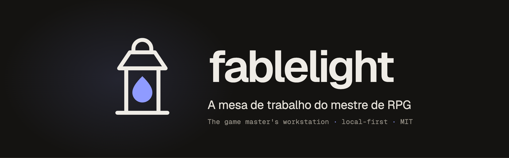
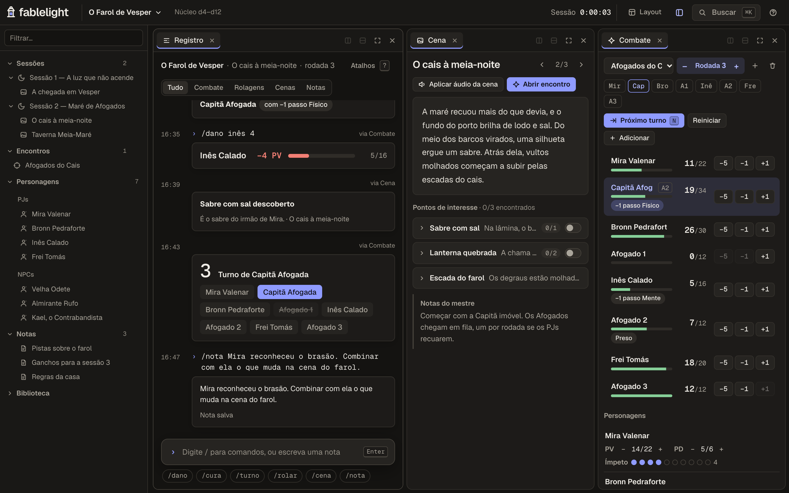
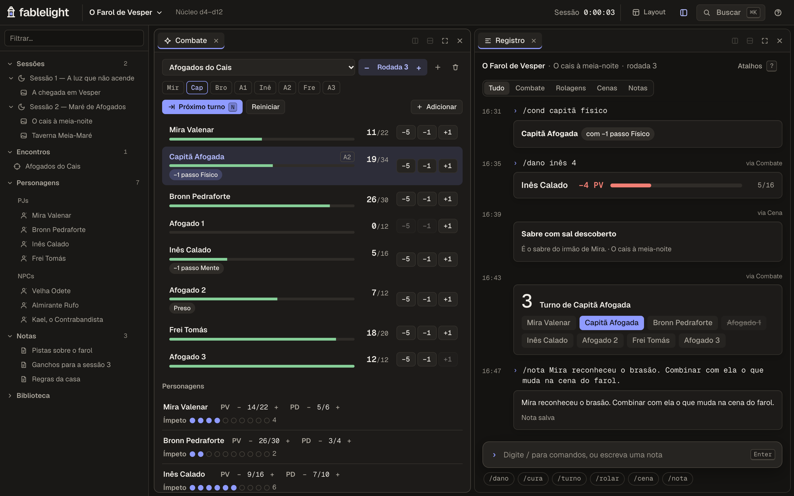
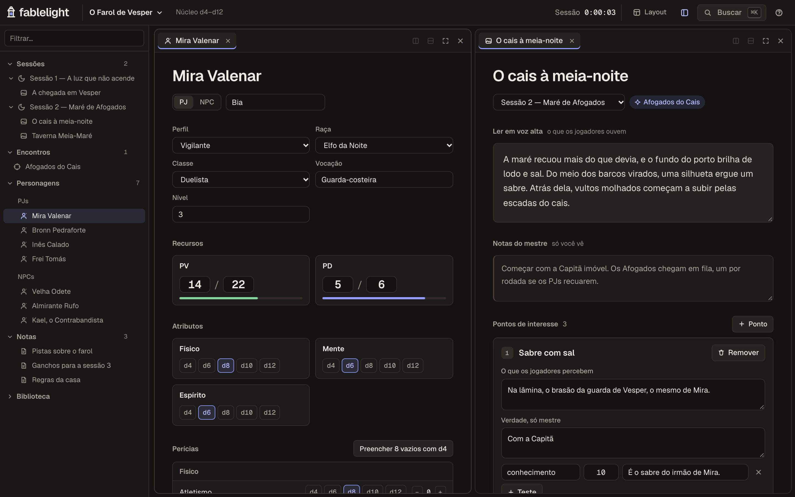
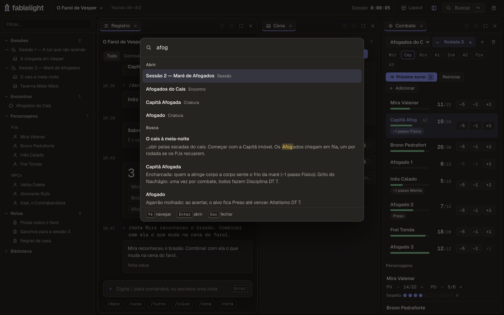
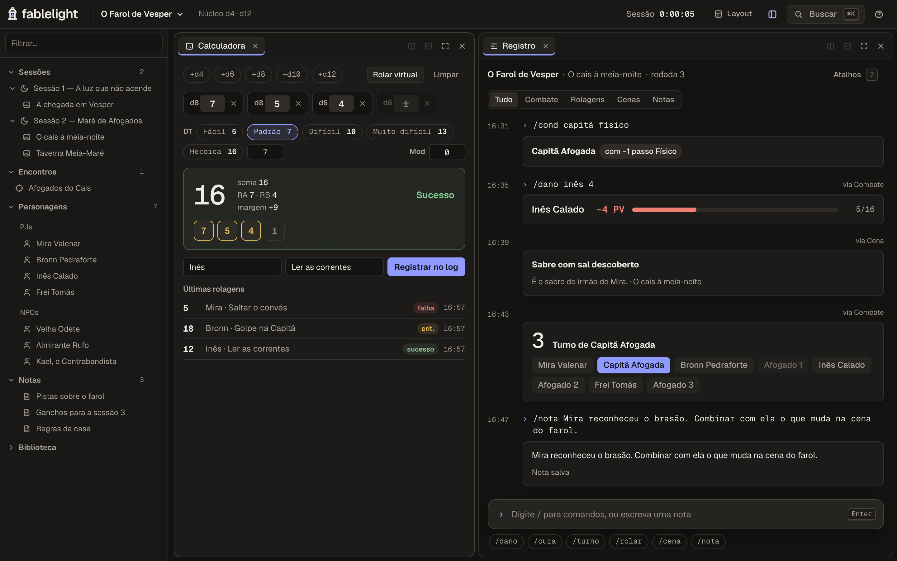
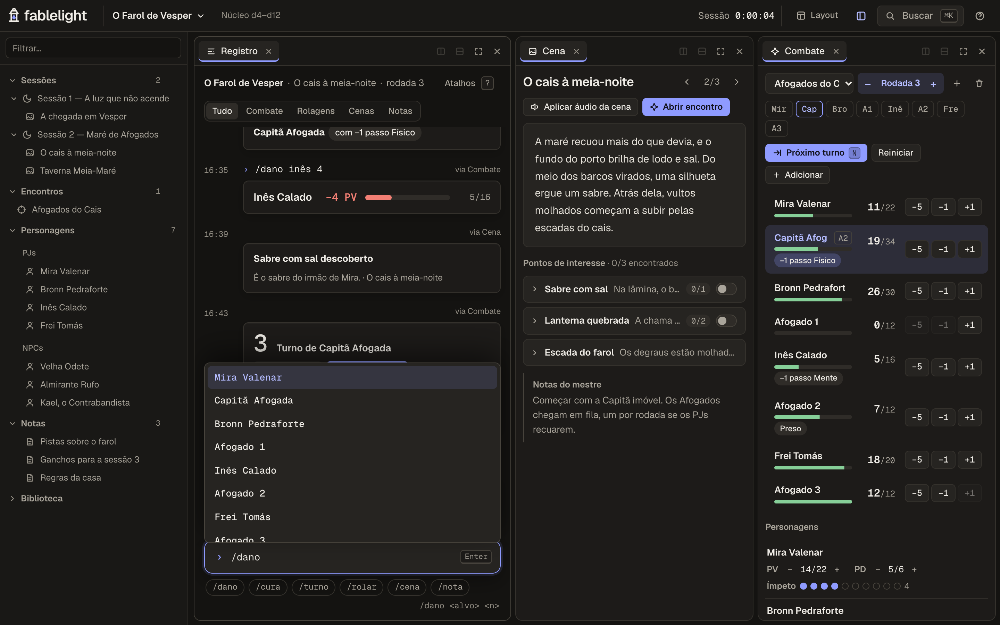

<p align="center">
  
</p>

<p align="center">
  <a href="LICENSE"></a>
  
  
  
</p>

<p align="center">
  <a href="#português">Português</a> ·
  <a href="#english">English</a> ·
  <a href="#instalação">Instalação</a> ·
  <a href="#atalhos">Atalhos</a> ·
  <a href="#roadmap">Roadmap</a>
</p>

<p align="center">
  
</p>

---

## Português

**Fablelight junta numa tela só tudo o que o mestre usa durante a sessão:** registro com comandos, cena preparada, combate, calculadora para dados físicos, busca nos livros e mixer de áudio. Funciona com qualquer sistema de RPG e com várias campanhas. Roda no seu computador, sem conta e sem nuvem.

### Por que

Mestrar costuma significar uma aba para a ficha, um PDF para a regra, uma planilha para a iniciativa, um bloco de notas para o que os jogadores acabaram de inventar e a calculadora do celular. Quando a mesa esquenta, você perde o fio entre eles.

No Fablelight esses itens são painéis da mesma janela. Você digita `/dano capitã 15` e a barra de PV se mexe, o evento entra no registro e dá para desfazer com `⌘Z`. Os dados ficam num arquivo SQLite na sua máquina.

### O que tem

<table>
<tr>
<td width="50%" valign="top">

**Registro da sessão**<br>
Linha do tempo de tudo o que acontece: dano, cura, condições, turnos, rolagens, cenas e notas, com filtros e agrupamento por sessão. Cada ação feita nos painéis também entra aqui.

</td>
<td width="50%" valign="top">

**Comandos no teclado**<br>
`/dano`, `/cura`, `/rolar`, `/cond`, `/turno`, `/cena`, `/nota`. Autocomplete de alvos, busca sem acento, histórico com `↑`.

</td>
</tr>
<tr>
<td valign="top">

**Combate**<br>
Iniciativa, PV com armadura, condições, rodadas, próximo turno na tecla `N` e dano rápido na tecla `D`.

</td>
<td valign="top">

**Cena ao vivo**<br>
Texto para ler em voz alta, notas do mestre e pontos de interesse com teste e DT. Marque o que os jogadores já descobriram.

</td>
</tr>
<tr>
<td valign="top">

**Calculadora de dados físicos**<br>
Digite o que caiu na mesa e ela aplica a regra do sistema: soma, maiores dados, crítico, falha, DT e margem.

</td>
<td valign="top">

**Explorador e abas**<br>
Sessões, cenas, encontros, personagens, notas e biblioteca numa árvore. Cada item abre numa aba, como um arquivo num editor de código.

</td>
</tr>
<tr>
<td valign="top">

**Tela do seu jeito**<br>
Divida, redimensione, maximize, arraste abas entre painéis e salve layouts com nome. Troque com `⌥1` a `⌥9`.

</td>
<td valign="top">

**Livros e áudio**<br>
Importe Markdown ou PDF e busque em milissegundos ignorando acentos. Trilha, ambiente e efeitos (arquivo local ou YouTube), com efeitos nas teclas `1` a `9`.

</td>
</tr>
</table>

<p align="center">
  
  
</p>
<p align="center">
  
  
</p>

### Uma sessão em comandos

```text
/cena cais                entra na cena e mostra o texto de abertura
/rolar 8 8 6 6 dt 7       pool contra DT 7: soma, descartes, veredito
/dano afogado 1 12        Afogado 1 cai a 0 PV, com barra no registro
/cond capitã físico       liga ou desliga "−1 passo Físico"
/turno                    passa a vez e destaca quem age
/nota Mira viu o brasão   salva a nota no registro
⌘Z                        desfaz o último dano
```

<p align="center">
  
</p>

Texto sem `/` vira nota. `/abrir <nome>` abre qualquer item numa aba e `/layout <nome>` troca o layout.

### Instalação

Precisa do [Node.js](https://nodejs.org) 24 ou mais recente.

```bash
git clone https://github.com/oMelqs/fablelight.git
cd fablelight
npm install
npm start        # compila e abre em http://localhost:4317
```

No macOS também dá para abrir com dois cliques em `Fablelight.command`.

Os dados ficam em `data/` (banco SQLite e arquivos enviados). Para fazer backup, copie essa pasta.

### Atalhos

| Atalho | Ação |
|---|---|
| `⌘K` | Paleta: comandos, itens, layouts e trechos dos livros |
| `/` | Foca o campo de comandos |
| `⌘B` | Mostra ou esconde o explorador |
| `⌘\` · `⌘⇧M` | Divide o painel · maximiza |
| `⌥W` · `⌥[` `⌥]` | Fecha aba · troca de aba |
| `⌥1`–`⌥9` | Troca de layout |
| `N` · `D` | Próximo turno · dano no combatente ativo |
| `1`–`9` | Efeitos sonoros |
| `⌘Z` | Desfaz o último dano |
| `?` | Lista de atalhos |

### Sistemas

Fablelight não assume regras. Cada sistema é um JSON com atributos, perícias, recursos, trilhas, condições, dificuldades e o modo de rolagem (`pool`, `d20`, `sum` ou `d100`). Fichas, combate e calculadora se adaptam a ele. Vêm dois de exemplo: um de pool de d4–d12 e um d20 genérico. Um trecho:

```json
{
  "name": "D20 genérico",
  "dice": [4, 6, 8, 10, 12, 20, 100],
  "attributes": [{ "key": "for", "label": "For" }, { "key": "des", "label": "Des" }],
  "resources": [{ "key": "pv", "label": "PV" }],
  "conditions": ["Caído", "Atordoado", "Envenenado"],
  "roll": { "mode": "d20" },
  "difficulties": [{ "label": "Média", "dt": 15 }, { "label": "Difícil", "dt": 20 }]
}
```

### Roadmap

O que existe hoje é a mesa do mestre. O que vem depois, sem data:

- [ ] **Visão dos jogadores**: uma tela separada com o que o mestre decide mostrar (cena, iniciativa, ficha própria).
- [ ] **Tela da TV**: a rota `/mesa` já existe no código, falta integrá-la ao fluxo da sessão.
- [ ] **Mais sistemas prontos**: modelos para os jogos mais usados na comunidade brasileira.
- [ ] **Exportar e importar campanhas** num único arquivo.

Tem uma ideia ou um sistema que você quer ver aqui? Abra uma issue.

### Desenvolvimento

```bash
npm run dev        # Vite (5173) + servidor com reload
npm test           # testes (node:test)
npm run typecheck  # TypeScript
```

Stack: Node 24 (`node:sqlite` com FTS5), Hono, React 18, Vite e CSS puro. Arquitetura e convenções em [`docs/design.md`](docs/design.md), interface em [`docs/workspace.md`](docs/workspace.md) e sistema visual em [`DESIGN.md`](DESIGN.md).

### Contribuindo

Contribuições são bem-vindas: abra uma issue para conversar sobre a ideia ou mande um pull request. Rode `npm test` e `npm run typecheck` antes.

### Licença

Código sob a [licença MIT](LICENSE). As fontes Geist e Geist Mono seguem a [SIL Open Font License](public/fonts/OFL.txt). A campanha das capturas de tela ("O Farol de Vesper") é original e foi escrita para este README.

---

## English

**Fablelight puts everything a game master reaches for during a session on one screen:** a command-driven session log, the prepared scene, combat, a calculator for physical dice, book search and an audio mixer. It works with any tabletop RPG system and multiple campaigns. It runs on your own computer, with no account and no cloud.

The interface is in Brazilian Portuguese for now.

### Why

Running a game usually means a tab for the sheet, a PDF for the rule, a spreadsheet for initiative, a notepad for whatever the players just invented, and your phone's calculator. When the table gets loud, you lose the thread between them.

In Fablelight those are panels of one window. Type `/dano capitã 15`, the HP bar moves, the event lands in the log, and `⌘Z` takes it back. Data lives in a SQLite file on your machine.

### Features

| | |
|---|---|
| **Session log** | A timeline of damage, healing, conditions, turns, rolls, scenes and notes. Actions taken in any panel are logged too. |
| **Keyboard commands** | `/dano`, `/cura`, `/rolar`, `/cond`, `/turno`, `/cena`, `/nota`, with target autocomplete and accent-insensitive search. |
| **Combat** | Initiative, HP with armor, conditions, rounds. `N` for next turn, `D` for quick damage. |
| **Live scene** | Read-aloud text, GM notes and points of interest with skill checks and DCs. |
| **Physical dice calculator** | Type what landed on the table and it applies the system's rule: sum, highest dice, critical, fumble, DC and margin. |
| **Explorer and tabs** | Sessions, scenes, encounters, characters, notes and library in a tree. Items open in tabs like files in a code editor. |
| **Your layout** | Split, resize, maximize, drag tabs between panels, save named layouts, switch with `⌥1` to `⌥9`. |
| **Books and audio** | Import Markdown or PDF and search instantly. Music, ambience and sound effects from local files or YouTube. |
| **System-agnostic** | Each system is a JSON file (attributes, skills, resources, tracks, conditions, difficulties, roll mode `pool`, `d20`, `sum` or `d100`). |

### A session in commands

```text
/cena cais                enter the scene and show its opening text
/rolar 8 8 6 6 dt 7       pool roll vs DC 7: sum, dropped dice, verdict
/dano afogado 1 12        Afogado 1 drops to 0 HP, bar shown in the log
/cond capitã físico       toggle "−1 Physical step"
/turno                    pass the turn and highlight who acts
/nota Mira saw the crest  save a note to the log
⌘Z                        undo the last damage
```

### Install

Requires [Node.js](https://nodejs.org) 24 or newer.

```bash
git clone https://github.com/oMelqs/fablelight.git
cd fablelight
npm install
npm start        # builds and serves http://localhost:4317
```

On macOS you can also double-click `Fablelight.command`. Data lives in `data/` (SQLite database and uploaded files); copy that folder to back it up.

Shortcuts: `⌘K` palette, `/` focus the command box, `⌘B` toggle the explorer, `⌘\` split, `⌘⇧M` maximize, `⌥1`–`⌥9` layouts, `N` next turn, `D` damage, `1`–`9` sound effects, `⌘Z` undo, `?` full list.

### Roadmap

Planned, no dates:

- [ ] **Player view**: a separate screen with what the GM chooses to show.
- [ ] **TV screen**: the `/mesa` route exists in the code and still needs to be wired into the session flow.
- [ ] **More ready-made systems.**
- [ ] **Export and import campaigns** as a single file.

### Development

```bash
npm run dev        # Vite (5173) + server with reload
npm test           # tests (node:test)
npm run typecheck  # TypeScript
```

Stack: Node 24 (`node:sqlite` with FTS5), Hono, React 18, Vite and plain CSS. Architecture notes are in [`docs/design.md`](docs/design.md) (Portuguese).

### Contributing

Contributions are welcome: open an issue to talk it through, or send a pull request. Run `npm test` and `npm run typecheck` first.

### License

Code under the [MIT License](LICENSE). The Geist and Geist Mono fonts are under the [SIL Open Font License](public/fonts/OFL.txt). The campaign in the screenshots ("O Farol de Vesper") is original and was written for this README.
